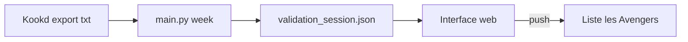

# Comida — courses Migros depuis Kookd

Comida relie **Kookd** (ce que tu veux cuisiner) et **Migros Online** (ce que tu mets au panier). Tu exportes la semaine depuis Kookd ; le programme détermine quoi acheter, à quel produit Migros ça correspond, en combien de paquets, puis envoie les lignes sur la liste **les Avengers**. Le paiement reste sur migros.ch.

Guide détaillé : [docs/guide.md](docs/guide.md) · Telegram : [docs/telegram-setup.md](docs/telegram-setup.md)

## Parcours hebdomadaire

1. **Kookd** — Recettes pour 8 portions, export `.txt` dans `exports/` (ex. `semaine.txt`).
2. **Analyse** — `uv run python main.py week exports/semaine.txt` (ou bouton « Lancer analyse » dans l’interface, port 8765).
3. **Validation** — Favoris manquants, quantités à confirmer, corrections (`validate.py refresh` après ajout sur [Mes produits](https://www.migros.ch/fr/my-products)).
4. **Push** — `validate.py push` ou « Pousser Migros » → liste **les Avengers**.
5. **Checkout** — Lien Migros pour créneau et paiement.

Tu peux remplir **les Avengers** à la main avec des promos du jeudi ; il n’y a plus d’export « liste Migros → Kookd ».



## Ce que fait `week`

| Étape | Rôle |
|--------|------|
| Parse | Lignes `quantité + unité + nom` (base 8 portions, `--portions` pour ajuster). |
| Garde-manger | `garde-manger.txt` retire ou réduit le stock ; lignes `+` = toujours acheter. |
| Courses hebdo | `courses-hebdo.txt` ajoute pain, œufs, etc. |
| Promos | Cache des promos Migros en ligne (~24 h, `--refresh-promos` pour forcer). |
| Matching | Un produit Migros par ingrédient à acheter. |
| Session | État dans `data/validation_session.json`. |

**Ordre de résolution** (pas un simple score flou) :

1. `mappings.json` — habitudes déjà apprises  
2. **Favori** Mes produits (priorité s’il est en promo)  
3. **Promo** de la semaine, même aliment  
4. **Recherche** API Migros  
5. Sinon → favori manquant, puis `validate.py refresh`

Un filtre **identité** impose le bon aliment (riz ≠ lait de riz, œufs ≠ beurre). `ingredient_guards.py` et les tests dans `tests/` couvrent les cas ambigus.

**Quantités** : nombre de paquets à partir du format Migros (`2 × 140 g`, grammes vs `1 Stück`, etc.). Les estimations (ex. mangue en g vs pièce) sont en **revue** dans l’UI : pas poussées tant qu’elles ne sont pas confirmées.

## Push

- Cible : **les Avengers** (`MIGROS_SHOPPING_LIST_NAME` dans `.env`).  
- Fusion des lignes au même `uid`, quantité **remplacée** sur la liste (API Migros en mode cible, pas cumul aveugle).  
- Auth : `.env` + scripts Node (`migros-mcp`, `migros-basket.mjs`).

## Interface et CLI

| Entrée | Usage |
|--------|--------|
| `main.py week` | Analyse + interface de validation |
| `main.py ui` | Rouvrir l’UI sur la session en cours |
| `validate.py` | `summary`, `refresh`, `push`, `basket`, `lists`, Telegram… |

Étapes UI : Kookd → Analyse → Validation → Push → Checkout.

## Fichiers utiles

| Fichier | Rôle |
|---------|------|
| `.env` | Compte Migros, liste les Avengers, Telegram (voir `.env.example`) |
| `garde-manger.txt` / `courses-hebdo.txt` | Stock maison + achats récurrents |
| `mappings.json` | Produits acceptés / refusés par ingrédient |
| `data/validation_session.json` | Semaine en cours (résolu, quantités, sources) |
| `exports/*.txt` | Exports Kookd |

## Installation rapide

```bash
cp .env.example .env   # renseigner Migros (+ TOTP si 2FA)
uv sync
npm install            # migros-mcp pour push / listes
uv run python validate.py lists
uv run python main.py week exports/semaine.txt
```

Tests : `uv run pytest`

## Telegram (optionnel)

Rappels jeudi/vendredi (liste Avengers, export Kookd + `week`), lien Tailscale vers l’UI, message après push si configuré. Voir [docs/telegram-setup.md](docs/telegram-setup.md).
