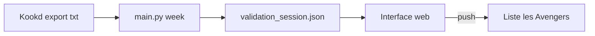

# Comida — courses Migros depuis Kookd

Comida relie **Kookd** (ce que tu veux cuisiner) et **Migros Online** (ce que tu mets au panier). Tu exportes la semaine depuis Kookd ; le programme détermine quoi acheter, à quel produit Migros ça correspond, en combien de paquets, puis envoie les lignes sur la liste **les Avengers**. Le paiement reste sur migros.ch.

Guide détaillé : [docs/guide.md](docs/guide.md) · Telegram : [docs/telegram-setup.md](docs/telegram-setup.md)

## Parcours hebdomadaire

1. **Kookd** — Recettes pour 8 portions, export `.txt` dans `exports/` (ex. `semaine.txt`).
2. **Analyse** — `uv run python main.py week exports/semaine.txt` (ou bouton « Lancer analyse » dans l’interface, port 8765).
3. **Validation** — Favoris manquants, quantités à confirmer, corrections (`validate.py refresh` après ajout sur [Mes produits](https://www.migros.ch/fr/my-products)).
4. **Push** — `validate.py push` ou « Pousser Migros » → liste **les Avengers**.
5. **Checkout** — Lien Migros pour créneau et paiement.

Tu peux remplir **les Avengers** à la main avec des promos du jeudi ; il n’y a plus d’export « liste Migros → Kookd ».



## Ce que fait `week`

| Étape | Rôle |
|--------|------|
| Parse | Lignes `quantité + unité + nom` (base 8 portions, `--portions` pour ajuster). |
| Garde-manger | `garde-manger.txt` retire ou réduit le stock ; lignes `+` = toujours acheter. |
| Courses hebdo | `courses-hebdo.txt` ajoute pain, œufs, etc. |
| Promos | Cache des promos Migros en ligne (~24 h, `--refresh-promos` pour forcer). |
| Matching | Un produit Migros par ingrédient à acheter. |
| Session | État dans `data/validation_session.json`. |

**Ordre de résolution** (pas un simple score flou) :

1. `mappings.json` — habitudes déjà apprises  
2. **Favori** Mes produits (priorité s’il est en promo)  
3. **Promo** de la semaine, même aliment  
4. **Recherche** API Migros  
5. Sinon → favori manquant, puis `validate.py refresh`

Un filtre **identité** impose le bon aliment (riz ≠ lait de riz, œufs ≠ beurre). `ingredient_guards.py` et les tests dans `tests/` couvrent les cas ambigus.

**Quantités** : nombre de paquets à partir du format Migros (`2 × 140 g`, grammes vs `1 Stück`, etc.). Les estimations (ex. mangue en g vs pièce) sont en **revue** dans l’UI : pas poussées tant qu’elles ne sont pas confirmées.

## Push

- Cible : **les Avengers** (`MIGROS_SHOPPING_LIST_NAME` dans `.env`).  
- Fusion des lignes au même `uid`, quantité **remplacée** sur la liste (API Migros en mode cible, pas cumul aveugle).  
- Auth : `.env` + scripts Node (`migros-mcp`, `migros-basket.mjs`).

## Interface et CLI

| Entrée | Usage |
|--------|--------|
| `main.py week` | Analyse + interface de validation |
| `main.py ui` | Rouvrir l’UI sur la session en cours |
| `validate.py` | `summary`, `refresh`, `push`, `basket`, `lists`, Telegram… |

Étapes UI : Kookd → Analyse → Validation → Push → Checkout.

## Fichiers utiles

| Fichier | Rôle |
|---------|------|
| `.env` | Compte Migros, liste les Avengers, Telegram (voir `.env.example`) |
| `garde-manger.txt` / `courses-hebdo.txt` | Stock maison + achats récurrents |
| `mappings.json` | Produits acceptés / refusés par ingrédient |
| `data/validation_session.json` | Semaine en cours (résolu, quantités, sources) |
| `exports/*.txt` | Exports Kookd |

## Installation rapide

```bash
cp .env.example .env   # renseigner Migros (+ TOTP si 2FA)
uv sync
npm install            # migros-mcp pour push / listes
uv run python validate.py lists
uv run python main.py week exports/semaine.txt
```

Tests : `uv run pytest`

## Telegram (optionnel)

Rappels jeudi/vendredi (liste Avengers, export Kookd + `week`), lien Tailscale vers l’UI, message après push si configuré. Voir [docs/telegram-setup.md](docs/telegram-setup.md).

## CI

`.github/workflows/ci.yml` lance quatre jobs à chaque pull request et à chaque push sur `main`, sur les machines de GitHub :

| Job | Lance | Échoue si |
|---|---|---|
| python | ruff, shellcheck sur `scripts/update.sh`, `uv run pytest` | import inutilisé, nom non défini, script shell fautif ou test en échec |
| node | `npm ci`, `node --check scripts/*.mjs` | `package-lock.json` désynchronisé ou erreur de syntaxe dans un script |
| docker | `docker build .` | l'image ne se construit pas |
| secrets | gitleaks sur tout l'historique git | un commit contient un token ou une clé (Telegram compris) |

Aucun job n'utilise de secret et le token GitHub des jobs est en lecture seule, donc une pull request depuis un fork peut lancer la CI sans risque.

La même vérification gitleaks et ruff tourne avant chaque commit une fois le hook installé (une fois par clone) :

```bash
uv tool install pre-commit && pre-commit install
```

Si un secret arrive sur GitHub, révoque-le et crée-en un nouveau. Le supprimer dans un commit suivant le laisse dans l'historique.

### Protéger `main`

La CI ne bloque un merge que si `main` l'exige. À faire une fois, par un admin du repo, après que la CI a tourné au moins une fois (GitHub ne propose un check dans la liste qu'après l'avoir vu) :

1. Settings > Rules > Rulesets > New ruleset > New branch ruleset.
2. Ruleset name : `main`. Enforcement status : Active.
3. Target branches > Add target > Include default branch.
4. Coche :
   - Restrict deletions.
   - Require a pull request before merging. Required approvals : 0 si tu travailles seul, 1 si quelqu'un relit tes PR.
   - Require status checks to pass. Coche aussi « Require branches to be up to date before merging », puis Add checks : `python`, `node`, `docker`, `secrets` (source GitHub Actions).
   - Block force pushes.
5. Bypass list : laisse vide. Avec Repository admin dans la liste, un admin peut encore pousser directement sur `main` en cas d'urgence.
6. Create.

Le repo étant public, vérifie aussi Settings > Actions > General > « Approval for running fork pull request workflows from contributors » : « Require approval for first-time contributors » (le défaut) suffit, puisque les jobs n'ont accès à rien.

## Serveur (Docker)

Comida tourne dans son propre conteneur `comida` (port 8765), à côté des autres services du serveur. Mise en place, une fois :

```bash
git clone https://github.com/louloupivron/EZGroceries ~/stacks/ezgroceries
cd ~/stacks/ezgroceries && cp .env.example .env   # renseigner Migros et Telegram
docker compose up -d --build
```

Mise à jour, après un merge dans `main` dont la CI est verte :

```bash
cd ~/stacks/ezgroceries && scripts/update.sh
```

Un simple `git pull` échoue dès que l'app a réécrit un fichier suivi par git : `mappings.json`, `garde-manger.txt`, `courses-hebdo.txt`, `data/validation_session.json`, `docs/index.html` ou `exports/semaine.txt`. `scripts/update.sh` :

1. s'arrête si le checkout n'est pas sur `main` ou a des modifications de code non commitées.
2. attend jusqu'à 15 minutes qu'une analyse `week` en cours se termine, car un redémarrage la tuerait.
3. archive `data/` et ces fichiers dans `data/backups/preupdate-<date>-<ancien commit>.tgz` (10 gardés).
4. récupère `origin/main` en fast-forward en gardant la copie du serveur des fichiers que l'app a modifiés, puis lance `docker compose up -d --build --force-recreate --wait`.
5. si le conteneur ne passe pas son healthcheck en 3 minutes, revient au commit précédent et reconstruit.
